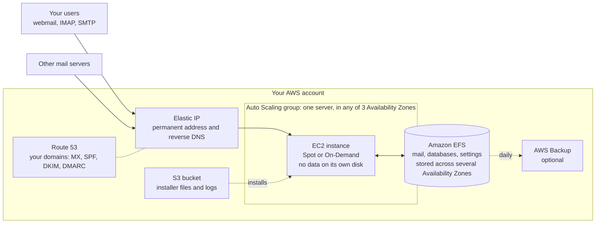

# Flashlight Mail Server

**Your company's own mail server in your own AWS account, installed by two CloudFormation templates.**

Flashlight is made for small companies that want to run their corporate mail themselves instead of handing it
to one of the big mail providers, without having to build and look after a mail server by hand. The mail,
the mailboxes and every setting stay in the company's own AWS account, under its control. There is no
per-user fee: you pay AWS for the resources the server uses, however many mailboxes you have.

Installing and supporting a mail server still takes some technical skill (see
[What you need](#what-you-need)). Flashlight automates the routine parts: installation, certificates, DNS
records, recovery after failures and upgrades.

## What you get

- Mail for one or several domains of your company
- Webmail in the browser (Roundcube), with mail filters and vacation replies
- IMAP and SMTP for any mail program: Outlook, Thunderbird, Apple Mail, phone apps
- An admin panel for mailboxes, aliases and quotas (PostfixAdmin)
- Trusted TLS certificates from Let's Encrypt, renewed automatically
- SPF, DKIM and DMARC records created and kept up to date automatically, so your mail is accepted by other
  servers and your domains are protected against forged senders
- Spam filtering (Rspamd): sender authenticity, blocklists of senders and links (Spamhaus with your free key,
  and others), content checks and a filter that learns from your mail. Spam goes to the Junk folder, obvious
  spam is refused before it arrives
- Protection against password guessing (fail2ban)
- Daily database backups, and optional backups of all data with AWS Backup

## How it works

Flashlight separates the **data** from the **server**. All data (mail, databases, certificates, keys and
settings) live on Amazon EFS, network storage that doesn't depend on any one server. The server itself is
disposable: it can be replaced at any moment by a new one that is built from scratch, picks up the same data
and the same IP address, and carries on.

The installation consists of two CloudFormation stacks:

- **Stage 1, address and DNS:** a permanent IP address (Elastic IP) with reverse DNS, the base DNS records of
  your domains in Route 53, and an S3 bucket with the installer files.
- **Stage 2, server:** a network (VPC) across three Availability Zones, the EFS storage, and the server
  itself, an EC2 instance run by an Auto Scaling group.

A third template, **maintenance mode**, stops the server while keeping all data. It is used for upgrades and
for adding domains.

### Reliability

- **The data are stored apart from the server.** EFS keeps them redundantly across several Availability Zones
  (data centers) of the region and is designed for 99.999999999% durability. They are encrypted on disk and on
  the way to the server.
- **A failed server is replaced automatically.** If the instance fails, or AWS takes back a Spot instance, the
  Auto Scaling group starts a new one, in another Availability Zone if needed. The new server installs itself,
  takes over the data and the IP address, and is in service within about ten minutes. Mail that other servers
  couldn't deliver in the meantime is retried by them and arrives; nothing is lost.
- **Nothing critical is on the server's own disk.** It holds only the operating system and programs, which
  are rebuilt on every replacement.
- **Only one server at a time.** A safeguard makes sure that two servers never write to the same data.
- **Fresh servers.** The server is rebuilt on schedule (every 30 days by default) with the current operating
  system updates.
- **Backups.** The databases are dumped every day and the dumps are kept for four weeks. AWS Backup can
  additionally back up the whole EFS storage, mail included, every day.

### Cost

You pay only for the resources the server uses now, and you change them when your needs change. There is no
need to buy capacity in advance "for growth":

- **Spot instances.** The server can run on Spot capacity, at a fraction of the regular price. Once a week it
  compares Spot prices and moves to a cheaper option when that saves enough. On-Demand is one setting away.
- **Reserved pricing for On-Demand.** A 1- or 3-year Reserved Instance or Savings Plan, bought in the AWS
  console, lowers the On-Demand price to about the Spot level (a 3-year t3a.small reservation comes to about $5
  a month), with no Spot interruptions. Nothing changes in the stacks.
- **The server size is a setting.** When the company grows, choose a larger instance type in a stack update:
  the server is replaced by a bigger one with the same data, without reinstalling anything. If the load drops,
  go back to a smaller one the same way.
- **Storage grows by itself.** EFS has no fixed size: you pay for the gigabytes of mail you actually have.
  Mail that nobody has opened for a month moves automatically to a storage class that is about ten times
  cheaper, and comes back on first access.

An example: **10 mailboxes with 30 GB of mail**, in the US West (Oregon) region, at AWS prices of November 2026
(before taxes):

| Resource | Spot instance | On-Demand instance |
|---|---|---|
| Server (t3.small / t3a.small) | $4 – $9 | $14 – $15 |
| Mail storage (EFS, 30 GB, mostly older mail) | $2 – $4 | $2 – $4 |
| Permanent IP address | $3.65 | $3.65 |
| Server disk, DNS zone, S3, logs | about $1 | about $1 |
| **Total per month** | **about $11 – $18** | **about $21 – $24** |

The cost doesn't depend on the number of mailboxes, only on the size of the server and the amount of mail.
Optional AWS Backup of the storage is billed separately by AWS.

## Software

All components are well-known open-source programs:

| Role | Software |
|---|---|
| Operating system | AlmaLinux 10 |
| Mail transfer (SMTP) | Postfix |
| Mailbox access (IMAP), filters (Sieve) | Dovecot |
| Message signing (DKIM) | OpenDKIM |
| Database | MariaDB |
| Web server | Apache with PHP |
| Webmail | Roundcube |
| Mailbox administration | PostfixAdmin |
| Database administration | phpMyAdmin |
| Certificates | Certbot (Let's Encrypt) |
| Spam filtering | Rspamd, with Valkey (its learned data) and Unbound (its DNS resolver) |
| Protection against password guessing | fail2ban |

Virus scanning is in development.

## What you need

- An AWS account, and your mail domains as hosted zones in Amazon Route 53.
- Outgoing mail allowed from the account. AWS blocks port 25 on new accounts by default; the block is lifted on
  request to AWS Support.
- Recommended: a free key of Spamhaus Blocklists via DNS Query for the spam filter
  ([sign up](https://www.spamhaus.com/data-access/free-data-query-service/)). Spamhaus answers queries from AWS
  only with a key; without it the filter works without Spamhaus.
- Working knowledge of the AWS console and CloudFormation, of DNS, and of basic Linux administration over SSH,
  for installation and for the rare case when something needs a closer look.
- Someone responsible for the server: watching that it runs, applying Flashlight upgrades, and keeping the
  server's reputation clean (no open relays, strong passwords).

## Documentation

- [Upgrading to a new release](docs/UPGRADING.md)
- [Releasing Flashlight](docs/RELEASING.md) (for developers)

An installation guide and a detailed description of the server are in preparation.
