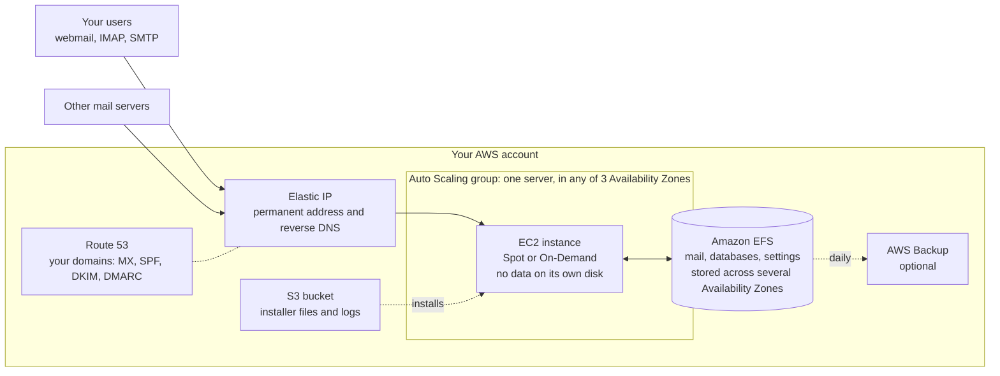

<!-- Copyright 2020-2026 Samson (https://github.com/georgio-sd). SPDX-License-Identifier: LicenseRef-PolyForm-Shield-1.0.0 (see LICENSE) -->
# Flashlight Mail Server

**Your company's own mail server in your own AWS account, with automated setup, recovery and upgrades.**

Flashlight is made for small and medium-sized companies that want to run their corporate mail themselves
instead of handing it to one of the big mail providers, without having to build and look after a mail server
by hand. The mail, the mailboxes and every setting stay in the company's own AWS account, under its control.
So do the logs: who logged in and from where, which messages came and went is recorded on the company's own
server, not at a mail provider. There is no per-user fee: you pay AWS for the resources the server uses,
however many mailboxes you have.

Three things came first in Flashlight's design: keeping the company's mail safe, keeping the server running, and
keeping its costs down. The routine work is automated: installation, certificates, DNS records, recovery after
failures and upgrades. Running a mail server still takes some technical skill, though (see
[What you need](#what-you-need)).

## What you get

- Mail for one or several domains of your company
- Webmail in the browser (Roundcube), with mail filters and vacation replies
- IMAP and SMTP for any mail program: Outlook, Thunderbird, Apple Mail, phone apps
- An admin panel for mailboxes, aliases and quotas (PostfixAdmin)
- A storage statistics page for the admin: who uses the mail storage, by domain and by mailbox, how it grows
  month by month, which mailboxes may no longer be read, and how much deleted mailboxes still hold
- Trusted TLS certificates from Let's Encrypt, renewed automatically
- SPF, DKIM and DMARC records created and kept up to date automatically, so your mail is accepted by other
  servers and your domains are protected against forged senders
- Spam filtering (Rspamd): sender authenticity, blocklists of senders and links (Spamhaus with your free key,
  and others), content checks and a filter that learns from your mail. Spam goes to the Junk folder, obvious
  spam is refused before it arrives. Optionally, attachments of risky file types (programs, scripts, disk
  images) are refused, as Gmail does. Office documents with suspicious macros go to the Junk folder (oletools)
- The spam filter learns from your users: moving a message into Junk, or the "Junk" button in webmail, teaches
  it what spam is; moving it out teaches it what isn't. A web interface for the admin shows why each message got
  its verdict, and keeps a whitelist of partner domains
- Outgoing mail is guarded against stolen passwords: users send only as their own addresses, at a pace of 30 messages
  an hour and 300 a day, with 20 recipients per message at most, and the admin gets an e-mail when a mailbox runs into these
  limits or sends spam
- Optional virus scanning of incoming mail (ClamAV) on medium or larger servers
- Protection against password guessing (fail2ban)
- Optional alert emails when the server is down and can't recover by itself
- Daily database backups, and optional backups of all data with AWS Backup

## How it works

Flashlight separates the **data** from the **server**. All data (mail, databases, certificates, keys and
settings) live on Amazon EFS, network storage that doesn't depend on any one server. The server itself is
disposable: it can be replaced at any moment by a new one that is built from scratch, picks up the same data
and the same IP address, and carries on.

The installation consists of two CloudFormation stacks:

- **Stage 1, address and DNS:** a permanent IP address (Elastic IP) with reverse DNS, the base DNS records of
  your domains in Route 53, and an S3 bucket with the installer files.
- **Stage 2, server:** a network (VPC) across three Availability Zones, the EFS storage, and the server
  itself, an EC2 instance run by an Auto Scaling group.

A third template, **maintenance mode**, stops the server while keeping all data. It is used for upgrades and
for adding domains.

### Reliability

- **The data are stored apart from the server.** EFS keeps them redundantly across several Availability Zones
  (data centers) of the region and is designed for 99.999999999% durability. They are encrypted on disk and on
  the way to the server.
- **A failed server is replaced automatically.** If the instance fails, or AWS takes back a Spot instance, the
  Auto Scaling group starts a new one, in another Availability Zone if needed. The new server installs itself,
  takes over the data and the IP address, and is in service within about ten minutes. Mail that other servers
  couldn't deliver in the meantime is retried by them and arrives; nothing is lost.
- **Nothing critical is on the server's own disk.** It holds only the operating system and programs, which
  are rebuilt on every replacement. The disk is encrypted too.
- **Memory peaks don't stop services.** A swap file, sized automatically, absorbs short peaks: the server slows
  down for a moment instead of losing a service. If that happens often, a larger instance type is one setting
  away.
- **Only one server at a time.** A safeguard makes sure that two servers never write to the same data.
- **Fresh servers.** The server is rebuilt on schedule (every 30 days by default) with the current operating
  system updates.
- **Backups.** The databases are dumped every day and the dumps are kept for four weeks. AWS Backup can
  additionally back up the whole EFS storage, mail included, every day.

### Cost

You pay only for the resources the server uses now, and you change them when your needs change. There is no
need to buy capacity in advance "for growth":

- **Spot instances.** The server runs On-Demand by default; Spot is one setting away, at a fraction of the price,
  with a short break in mail when AWS takes an instance back. On Spot, the server compares prices once a week and
  moves to a cheaper option when that saves enough.
- **Reserved pricing for On-Demand.** A 1- or 3-year Reserved Instance or Savings Plan, bought in the AWS
  console, lowers the On-Demand price to about the Spot level, with no Spot interruptions. Nothing changes in
  the stacks: keep the second instance type (InstanceType2), so the server stays up even when AWS is short of
  the reserved type.
- **The server size is a setting.** When the company grows, choose a larger instance type in a stack update:
  the server is replaced by a bigger one with the same data, without reinstalling anything. If the load drops,
  go back to a smaller one the same way. Which size fits how many users, measured with load tests:
  [Choosing the instance type](docs/INSTALL.md#choosing-the-instance-type).
- **Storage grows by itself.** EFS has no fixed size: you pay for the gigabytes of mail you actually have.
- **Old mail costs less.** Mail that nobody has opened for a month moves to the much cheaper Infrequent Access
  storage class by itself, and comes back on first access (MailStorageLifecyclePolicy: 7 to 90 days, or off).

An example: **100 mailboxes with 300 GB of mail**, 200 GB of it older mail in Infrequent Access, on a t3.medium
in US West (Oregon), at AWS prices of November 2026 (before taxes). A company of this size usually prefers no
Spot interruptions, so the server is On-Demand, with or without a reservation:

| Resource | On-Demand | Reserved, 1 year | Reserved, 3 years |
|---|---|---|---|
| Server (t3.medium) | $30.37 | $19.05 | $13.14 |
| Mail storage (EFS: 100 GB Standard, 200 GB Infrequent Access) | $35.00 | $35.00 | $35.00 |
| Permanent IP address | $3.65 | $3.65 | $3.65 |
| Server disk, DNS zone, S3, logs | about $1.50 | about $1.50 | about $1.50 |
| **Total per month** | **about $70** | **about $59** | **about $53** |

That is $0.50 to $0.70 per mailbox a month. Reserved prices are for no upfront payment; paying upfront lowers them a
little more. Not included: reading or moving mail in Infrequent Access ($0.01 per GB, usually cents), CPU credits if
the server works above its baseline for long (see [t3 CPU credits](docs/INSTALL.md#t3-cpu-credits)), and data sent
out to users beyond AWS's free 100 GB a month. Optional AWS Backup of the storage is billed separately by AWS.

## Software

All components are well-known open-source programs:

| Role | Software |
|---|---|
| Operating system | AlmaLinux 10 |
| Mail transfer (SMTP) | Postfix |
| Mailbox access (IMAP), filters (Sieve) | Dovecot |
| Message signing (DKIM) | OpenDKIM |
| Database | MariaDB |
| Web server | Apache with PHP |
| Webmail | Roundcube |
| Mailbox administration | PostfixAdmin |
| Database administration | phpMyAdmin |
| Certificates | Certbot (Let's Encrypt) |
| Spam filtering | Rspamd, with Valkey (its learned data) and Unbound (its DNS resolver) |
| Macros in Office documents | oletools (through olefy) |
| Virus scanning (optional) | ClamAV |
| Protection against password guessing | fail2ban |

## What you need

- An AWS account, and your mail domains as hosted zones in Amazon Route 53.
- Outgoing mail allowed from the account. AWS blocks port 25 on new accounts by default; the block is lifted on
  request to AWS Support.
- Recommended: a free key of Spamhaus Blocklists via DNS Query for the spam filter
  ([sign up](https://www.spamhaus.com/data-access/free-data-query-service/)). Spamhaus answers queries from AWS
  only with a key; without it the filter works without Spamhaus.
- Working knowledge of the AWS console and CloudFormation, of DNS, and of basic Linux administration over SSH,
  for installation and for the rare case when something needs a closer look.
- Someone responsible for the server: watching that it runs, applying Flashlight upgrades, and keeping the
  server's reputation clean (no open relays, strong passwords).

## Documentation

- [Installing Flashlight](docs/INSTALL.md): installation, first steps and everyday tasks
- [How the server works](docs/ARCHITECTURE.md): a detailed description of the server
- [Upgrading to a new release](docs/UPGRADING.md)
- [Releasing Flashlight](docs/RELEASING.md) (for developers)

## License

Flashlight is free to use, including by companies for their own mail, under the
[PolyForm Shield License 1.0.0](LICENSE). You may use, change and share it for any purpose except offering a product
or service that competes with Flashlight or with what its author offers with it: selling it, hosting it for
others, or selling support for it, for example. Such uses are possible with the author's permission, under a
separate agreement: contact the author through GitHub (https://github.com/georgio-sd). The source is open to
read: Flashlight is source-available, not open source.

Components from other projects keep their own licenses: see [THIRD-PARTY.md](THIRD-PARTY.md). Bug reports,
feature requests and pull requests are welcome: see [CONTRIBUTING.md](CONTRIBUTING.md).
