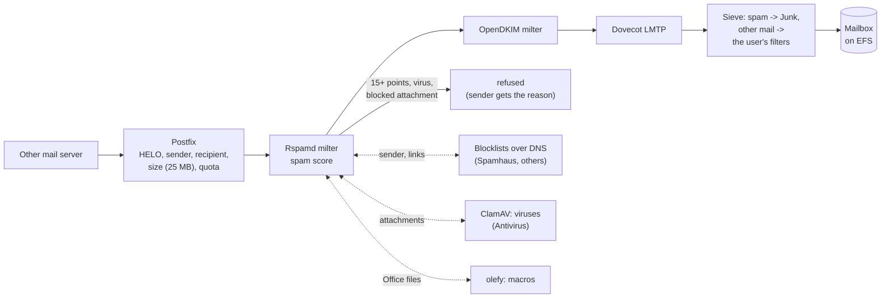

<!-- Copyright 2020-2026 Samson (https://github.com/georgio-sd). SPDX-License-Identifier: LicenseRef-PolyForm-Shield-1.0.0 (see LICENSE) -->
# How the Flashlight server works

This document describes how a Flashlight mail server is built and how it behaves: what the stacks create, how an
instance installs itself, where the data are, how mail flows through the server, and what protects it. It is
for administrators who want to understand the server in depth, and for developers of Flashlight. The day-to-day
tasks are in the [installation guide](INSTALL.md).

## The main idea

The data and the server are kept apart. Everything that must survive (mail, databases, certificates, keys,
passwords, the admin's settings) lives on Amazon EFS. The EC2 instance holds only the operating system and the
programs, and is disposable: any instance can be replaced at any time by a new one that installs itself from
scratch, mounts the same EFS, takes the same Elastic IP and carries on.

So there is one way the server comes into being, and it is used for everything: the first install, a Spot
interruption, a failed instance, a scheduled rebuild, a change of the instance type, an upgrade. Each of these
is "a new instance installs itself over the existing data".

## Stacks and resources

### Stage 1: `1-dns-preset.yaml`

| Resource | Purpose |
|---|---|
| Elastic IP | The server's permanent address |
| S3 config bucket | The installer files of the release; `install-logs/` (logs of failed installs, 90 days); `upload/` (the admin's folder) |
| Lambda DownloadBundles | Copies the release's installer files from the public Flashlight bucket into the config bucket. Runs on every stack create and update. On the rollback of a failed first creation it empties the bucket, so CloudFormation can delete it (it tells such a rollback by the stack's status); a normal delete leaves the bucket to the admin |
| Lambda DnsPreset | Finds the newest Flashlight image (AMI) and copies it into the account's region if needed, waiting until the copy can be used; creates the A records of `mail.` and `admin.` in the main zone and an MX record in every mail zone; sets reverse DNS of the Elastic IP to `mail.<main domain>`. On deletion, or when a domain leaves the list, it removes Flashlight's values from these records and from DKIM, SPF and DMARC, leaving other values of the same records alone. On the rollback of a failed first creation (its own failure, or the stack's status `ROLLBACK_IN_PROGRESS`) it removes only the A records with the stack's address, which is released next; the MX, DKIM, SPF and DMARC records stay, as the domain may have had them before the install |
| Server image (AMI), not a stack resource | DnsPreset's copy of the Flashlight image in the account's region, with its snapshot; stage 2's instances start from it. One copy serves every Flashlight stack in the region. CloudFormation doesn't know about it: it stays when the stack is deleted, and an older copy stays when a newer image comes, until you deregister it (see [Old server images](INSTALL.md#old-server-images)). Its tags: see [Tags](#tags) |
| Log groups | The logs of the two functions |

The stage 2 stack reads stage 1's outputs (the address, the bucket, the image, the domains) through
CloudFormation exports. That's why stage 1 can't change its domain list or the image while stage 2 uses them.

### Stage 2: `2-deployment.yaml`

| Resource | Purpose |
|---|---|
| VPC, Internet gateway, 3 public subnets, route table | The network, one subnet per Availability Zone (2 with TwoAZoneConf) |
| Instance security group | Inbound 22, 25, 80, 143, 443, 465, 587, 993 from anywhere |
| EFS file system, 3 mount targets, security group | The mail storage, reachable from the instance only (NFS) |
| IAM role and instance profile | What the instance may do in AWS (see [Security](#security)) |
| Launch template | Image, type, encrypted root disk, UserData |
| Auto Scaling group | Exactly one instance (min = max = 1) in any of the zones, Spot or On-Demand |
| SNS topic, up to 3 email subscriptions, CloudWatch alarm | Alert emails, only with AlertEmail (see [Alert emails](#alert-emails)) |

The Auto Scaling group uses a mixed instances policy with up to two interchangeable types (InstanceType and
InstanceType2) and, for Spot, the `price-capacity-optimized` allocation strategy. It waits up to 30 minutes for
the instance's success signal (CreationPolicy). A stack update that changes the launch template creates a new
Auto Scaling group (AutoScalingReplacingUpdate): the old instance runs until the new one has signalled success,
and if the new one fails, the update rolls back and the old one stays.

The template's Rules refuse combinations that can't work: a Spamhaus key or the antivirus without the spam
filter, the antivirus on small instance types, a second instance type that isn't the pair of the first (t3a for
t3, c6a for c7i, m6a for m7i: the same size and memory), a disk too small for the swap file.

### Maintenance mode: `x-maintenance.yaml`

The same template as stage 2 without the launch template, the Auto Scaling group and the alarm that watches the
group, generated from it by `build/make-maintenance.py`. Updating stage 2 to it removes the instance and keeps
everything else: the network, EFS, the IAM role, the alert topic with its confirmed subscriptions. It's used for
upgrades and for changing the domain list.

### Tags

Every resource of both stacks that can be tagged has `Name` = `<stack name>-Flashlight` and
`flashlight:installation` = the stage 1 stack name (stage 2 takes it from its DnsPreset parameter), so the two
stacks of one server have one value for the billing. The instance gets both from the Auto Scaling group
(PropagateAtLaunch); its disk and network interface get them from the launch template (TagSpecifications), as
does the launch template itself. The EFS backups (AWS Backup recovery points) get the file system's tags from
AWS Backup. The instance also has `flashlight:instance-types` and `flashlight:lifecycle`
(see above). DnsPreset tags the image copy it makes and its snapshot with `Name` = the image name
(`Flashlight AlmaLinux …`) and
`flashlight:installation` = its own stack's name: the copy counts for the server that copied it, though other
stacks in the region may use it too. Its role may tag only as it
copies (`ec2:CreateAction` = `CopyImage`), so a copy made before tags existed stays untagged until the next
image. Not tagged: what can't carry tags (the instance profile, the EFS mount targets, routes and
associations, SNS subscriptions), short-lived Spot requests, and the network objects the VPC makes by itself
(main route table, default network ACL and security group).

## The life of an instance

### Install

1. **UserData** (in the launch template) sets up the basics: turns SELinux off, makes the AWS CLI retry
   temporary errors, updates the operating system (`dnf upgrade`), installs the AWS CLI, downloads
   `install-finish` first (so even an install that can't go on is reported), then downloads and runs `base.sh`
   from the config bucket, stopping it after 60 minutes if it hangs. The install log goes to the root-only
   `/var/log/flashlight-install.log`. It traces every command, except the steps that handle passwords and keys:
   those show only a `+ secret_step <what it does>` line, so the log, also its copy in the config bucket, holds
   no passwords.
2. **`base.sh`** does the rest:
   - turns off what the image runs but the server doesn't need: IPv6 (the VPC has none), amazon-ssm-agent, EC2
     Instance Connect's SSH key lookup (`/etc/ssh/sshd_config.d/50-flashlight.conf`), nm-cloud-setup (it sets
     up extra IPs and network interfaces from the instance metadata, while the server has one interface with one
     IP), fwupd, the dnf cache refresh, SSSD and gssproxy;
   - makes the services that keep data on EFS start only after it is mounted, and start again by themselves
     30 seconds after a crash;
   - mounts EFS (TLS) at `/mnt/mailserver`, with an NFS client identity of its own, and installs the helper
     scripts;
   - stops if the data on EFS belong to a newer Flashlight release;
   - associates the Elastic IP;
   - writes its own flag `flag-ec2id-<instance id>` on EFS, which makes any other running instance stop its
     services (see [Only one instance](#only-one-instance));
   - installs the packages (EPEL from the branch of this AlmaLinux minor release), quiets known harmless
     warnings, closes the instance metadata to everyone but root (nftables), creates swap and raises the inotify
     limit for IMAP IDLE;
   - starts MariaDB and, if the data are from an older release, upgrades them (see [UPGRADING](UPGRADING.md));
     creates the database of the storage statistics where it is missing;
   - on existing data, updates a web application whose installed package (in `versions`) is older than the
     release's, with its own upgrade steps, a backup, and a restore on a failure;
   - on the first install only: creates the databases, the passwords, the certificates (a later install
     replaces a test certificate when CertificateMode is switched to production);
   - rebuilds every configuration file from the release, then applies the admin's own settings files;
   - sets up the stack's options: the spam filter (Rspamd with Valkey, Unbound and olefy), the antivirus,
     fail2ban;
   - adds new domains of the stack to PostfixAdmin, creates DKIM keys and DNS records;
   - writes Flashlight's block of cron jobs, starts the Spot watcher (on Spot) and the watch for another
     instance taking over the EFS;
   - records the versions of the packages that work with the data, and writes the list of its services for the
     helper scripts.
3. **`user-script.sh`**, if the admin put one into the config bucket, runs next. Its failure is reported
   (`USER` line) but doesn't fail the install.
4. **`install-finish result`** decides: on success it writes the EFS `flag` (the first install is done) and
   schedules a check for after the reboot; on failure, see below. After a good install the instance reboots, into
   the new kernel if the update brought one. A failed install doesn't reboot, so the services configured before
   the failure never start on a half-configured server.
5. **`install-finish ready`** runs once after the reboot: when all services of the list are up (it waits up to
   2 minutes), it writes `READY` to the event log and signals SUCCESS to CloudFormation.

An install takes 6 to 10 minutes from the instance's start to READY, depending on the instance type and on
whether the antivirus database must be downloaded.

### When an install fails

`install-finish` keeps the install log in the config bucket (`install-logs/`), which survives even when the stack
rolls back and deletes the EFS, and writes a `FAILED` line naming the command that failed. An install still
running after 60 minutes (hung on a download, for example) is stopped and fails the same way. Then:

- **during a stack create or update:** it signals FAILURE at once, so the rollback starts in a minute instead of
  after the 30-minute timeout. No retry: the person running the update takes over.
- **during a replacement by the Auto Scaling group** (Spot, price check, rebuild, health check): it tries a new
  instance after 5 minutes, up to 3 failed installs in 3 hours. After that the last instance stays up for
  diagnosis. With AlertEmail, the first failure and the last one send an alert email, and so does the first
  working install after failures (see [Alert emails](#alert-emails)).

If the install can't even start (the AWS CLI can't be installed, or the config bucket can't be read), there is no
`install-finish` to report it. UserData then sends the alert email itself (with the AWS CLI, or without it with
`curl` signing the request with the instance role's keys), and the instance turns itself off after 30 minutes,
which terminates it, and the Auto Scaling group starts a new one. Until an install works, this repeats about
every 35 minutes, with one alert email each time.

### Alert emails

Only with the AlertEmail parameter (up to 3 addresses); without it, none of this is created. Stage 2 creates an
SNS topic with an email subscription per address; AWS sends each address a confirmation email, and an address
that doesn't confirm within 48 hours is dropped by AWS. Subscriptions follow the position in the list: removing
an address subscribes the ones after it again, and each gets a new confirmation email (in a test SNS kept the
address's confirmed subscription, which AWS doesn't document, so INSTALL asks to click the link).
CloudFormation doesn't notice an address that unsubscribed or was dropped; updating the stack without it and then
with it subscribes it again. The server never subscribes anyone itself.

| Event | Sent by | Emails |
|---|---|---|
| An install after a replacement failed | `install-finish` | The first failure ("retrying"; a new instance tries 5 minutes later), the last of 3 failures within 3 hours ("server is DOWN"; that instance stays up for diagnosis), and the first working install after failures ("up again"; the newest failure log it reported is kept in `log/alert-last-failure` on EFS, so each run of failures gets one). If the stack's status can't be read, one email ("no retry") and no further attempt. Stack creates and updates send none: the person running them watches |
| The install can't start | UserData | One per attempt, about every 35 minutes. No "up again" afterwards: without the bucket and EFS the instance has nowhere to record the failure |
| No instance for 15 minutes | CloudWatch alarm `<stack>-no-mail-server-instance` on the group's `GroupInServiceInstances` metric (collected only with AlertEmail, at no cost) | ALARM once, OK when an instance runs again. AWS has no capacity for the instance types (Spot or On-Demand); a normal replacement leaves the group empty for a few minutes only. A new alarm goes from INSUFFICIENT_DATA to OK and sends one OK email: when AlertEmail is set on an existing stack and when maintenance ends (the alarm is made again). A stack update keeps the alarm and its state |

At `READY`, `install-finish` also compares AlertEmail (read from the stack's parameters) with the topic's
subscriptions and writes a `WARN` line for each address that isn't confirmed yet or has no subscription. The
instance role may publish to the topic and list its subscriptions, nothing else in SNS.

The warnings about mailboxes that may have been taken over are not alert emails: `outbound-alert` sends them as
ordinary mail to AdminEmail (see [Outgoing mail and compromised mailboxes](#outgoing-mail-and-compromised-mailboxes)).

### Replacements

| Cause | What happens |
|---|---|
| Spot interruption | `spot-instance-shutdown` (the `autoshutdown` service) watches the instance metadata for the 2-minute notice. On it, `replace-instance` stops the services cleanly and asks the Auto Scaling group for a new instance |
| Weekly Spot price check (Spot only) | `spotprices.py`, Saturday-to-Sunday night 01:15: compares the 7-day average price of this instance's pool (type and zone) with every pool the group may use (InstanceType and InstanceType2 in each zone). If it is 30% or more above the cheapest, the instance asks to be replaced; the group picks the new pool |
| Scheduled rebuild | `rebuild-check`, Sundays 03:15: once the current instance is older than RebuildAfterDays (counted from the last replacement, or from the first install if there was none; reboots don't reset it), it asks to be replaced, so the server runs on current packages |
| Failed instance | The Auto Scaling group's EC2 health check replaces it |
| Failed install after a replacement | `install-finish` terminates the instance and the group starts a new one, up to 3 installs in 3 hours (see [When an install fails](#when-an-install-fails)) |
| Stack update that changes the launch template (image, instance type, a parameter the install uses) | A new Auto Scaling group with a new instance; the old one is removed after the new one's success |

The times are in the server's time zone (TimeZone). In each case the new instance goes through the same install.
Mail is down for about 6 to 10 minutes; other mail servers retry and deliver later.

### Only one instance

Two instances must never write to the same data. The Auto Scaling group has at most one instance, and every
replacement terminates the old instance first, but a stack update makes a new group while the old one still
runs. The `double-inst-prot` service runs `services-shutdown`, which checks the EFS flags every 15 seconds: when
a newer instance writes its flag (before it installs its packages, minutes before it starts MariaDB), this one
stops every service that writes to EFS (MariaDB, Postfix, Dovecot, Apache and PHP-FPM, OpenDKIM, Rspamd, Valkey,
the antivirus updater, cron with Flashlight's jobs, the log rotation and certificate renewal timers) and the
Spot watcher, so it can't ask for yet another instance, and waits. What keeps running only reads EFS or works
locally (fail2ban, the virus scanner, Unbound); the event log gets this instance's `STOP` line. Usually it's
terminated soon after. If instead the newer instance is terminated first (its install failed and the update
rolled back), this one takes over again: its flag, its services, the Elastic IP. It doesn't take over data that
the newer instance has already upgraded to a newer release.

### The event log

`/mnt/mailserver/log/instance.log` has one line per event, with the time, instance ID, type and zone:

| Event | Meaning |
|---|---|
| BOOT | A new instance starts installing (logged once EFS is mounted, after the OS update) |
| READY | Installed, rebooted, services up |
| FAILED | An install, a data upgrade or a web application update failed, with the reason and where the log is |
| REPLACE | The instance asks for a replacement, and why |
| SHUTDOWN, REBOOT | The instance goes down or reboots |
| STOP, RESUME | The instance stops its services (before its own replacement, or for another instance that took over the EFS), or takes over again |
| UPGRADE | Data upgrades between releases, and web application updates |
| CERT | The switch from the test certificate to a trusted one (CertificateMode), or why it didn't work |
| MAILBOX | Deleted mailboxes: mail moved to the trash, a Roundcube user removed, trash deleted for good after 30 days |
| BACKUP | The daily database dump |
| ALERT | A mailbox that may be compromised |
| CHECK, ERROR | The weekly Spot price check: its decision with the prices, or why it couldn't compare |
| WARN | Something works with less than planned or needs a look: swap made smaller, oletools not installed, the storage statistics database not set up or the nightly statistics had errors, an alert email not sent or an AlertEmail address not confirmed, the spam filter's data over 85% of Valkey's memory cap, a second SPF record of a domain deleted, a web application newer than the release's kept |
| USER | The admin's user-script.sh failed |

The file isn't rotated: a server in normal use adds about 30 KB a month.

## Data on EFS

| Path | Contents |
|---|---|
| `mail/<domain>/<address>/` | Mailboxes (Maildir), owned by the `vmail` user (5000) |
| `mail/sieve/`, `mail/shared-folders/` | Users' Sieve filters, shared folders |
| `mail/.deleted/` | Mail of deleted mailboxes, kept 30 days |
| `mysql/` | MariaDB data |
| `spool/postfix/` | The Postfix queue |
| `etc/letsencrypt/` | Certificates |
| `etc/postfix/dkim/` | DKIM keys and OpenDKIM's config |
| `etc/crontab` | The system crontab: Flashlight's block and the admin's own lines |
| `etc/<program>/` | The admin's own settings files |
| `www/admin/` | PostfixAdmin and phpMyAdmin (updated only when a release brings a newer version; their configs are rewritten at every install), the admin site's password file (`.htpasswd`, made at the first install), its start page (`index.html`), the Mail storage statistics page (`storage_stats/index.php`) and the site's icon (`favicon.svg`), the last three rewritten at every install from `apache/` |
| `www/webmail/` | Roundcube: the application (updated like the admin applications), its config (rewritten at every install), `temp/` and `logs/` (rotated weekly, kept 13 weeks) |
| `rspamd/` | The spam filter's web interface settings, statistics, graphs, whitelist |
| `valkey/` | What the spam filter has learned |
| `clamav/` | The antivirus signatures (only while Antivirus is enabled) |
| `root/` | `credentials`, `secrets` (generated passwords and keys), `unbanip` (how to lift a fail2ban ban) |
| `automation/` | Flashlight's scripts: the cron jobs, the Spot watcher, `replace-instance` |
| `backup/` | Database dumps (28 days) and upgrade backups (90 days) |
| `log/` | `instance.log`, the log of every install (`install/`, 90 days), and the state files of the alert emails (`alert-last-failure`) and of `outbound-alert` |
| `versions` | The Flashlight release of the data, and what the last instance ran: its image and OS, the web applications, and the packages that work with the data (MariaDB, Dovecot, Rspamd, Valkey) |
| `flag`, `flag-ec2id-<id>` | The first install is done; the instance that owns the EFS now |

The file system outlives the stack (`DeletionPolicy: RetainExceptOnCreate`): deleting the stage 2 stack leaves it
in the account, to be deleted by hand; its name (`<stack>-Flashlight`) tells whose it is. EFS is encrypted at
rest, and the instance mounts it over TLS. With MailStorageLifecyclePolicy, files not read for a while move to
the Infrequent Access class.

Each instance introduces itself to EFS with its own NFS client identity, the instance ID (`nfs4_unique_id`,
set in `/etc/modprobe.d/flashlight-nfs.conf`). By default Linux uses the hostname, which the old and the new
instance share during a replacement: EFS would take them for one client, and when one of them reconnected or
unmounted, it would wipe the other's state, so the new server could lose its file locks (the kernel's
`NFS: lost N locks`).

## Configuration: Flashlight's and the admin's

Flashlight's configuration files are rewritten from the release at every install, that is on every new instance
(a reboot of the same instance doesn't rewrite them; "at every boot" in the files' headers means the same), so
they always match the installed programs and the release. Most live on the instance (in `/etc`); the configs of
the web applications, OpenDKIM's config and Flashlight's block of the crontab live on EFS next to what they
configure, and are rewritten all the same. They carry a "DON'T EDIT" header. A handful of values in them come
from the stack's parameters and from `root/secrets`.

The admin's settings live in separate files on EFS, created once with an explanation and never changed by
Flashlight. Each program reads them after Flashlight's, so they win:

| Program | The admin's file | How it is applied |
|---|---|---|
| Postfix | `etc/postfix/main.local.cf` | Each setting applied with `postconf -e` at boot; a rejected one is reported and skipped |
| Dovecot | `etc/dovecot/custom.conf` | Included at the end of `dovecot.conf` |
| Apache | `etc/httpd/custom.conf`, `custom-mail.conf`, `custom-admin.conf` | Global, inside the webmail site, inside the admin site |
| MariaDB | `etc/mariadb/custom.cnf` | Read after `flashlight.cnf` |
| Rspamd | `etc/rspamd/override.d/` | Linked as `/etc/rspamd/override.d`; a file replaces the whole section of that name |
| fail2ban | `etc/fail2ban/custom.local` | Read after `jail.local`; starts as commented examples from the release |
| Mail storage statistics | `etc/storage-stats/custom.ini` | The thresholds of the page's amber marks, read at every visit |
| Roundcube, PostfixAdmin, phpMyAdmin | `etc/roundcube/custom.inc.php`, `etc/postfixadmin/custom.php`, `etc/phpmyadmin/custom.php` | Included at the end of Flashlight's config |

OpenDKIM has no file of the admin's. For changes that aren't settings (extra packages, for example), the admin's
`user-script.sh` in the config bucket runs after every install (see [Install](#install)).

The crontab is shared: Flashlight's jobs are between `# Flashlight begin` and `# Flashlight end`, rewritten at
every install; lines outside belong to the admin.

## Services

| Service | Role | Listens on |
|---|---|---|
| Postfix | SMTP: receives and sends mail | 25 (other servers), 587 and 465 (users) |
| Dovecot | IMAP, login checks for Postfix, delivery (LMTP, a Unix socket for Postfix only), the quota check before Postfix takes a message (a full mailbox is refused at once, not bounced later), ManageSieve | 143, 993; 4190 (closed from outside) |
| OpenDKIM | Signs outgoing mail | 127.0.0.1:8891 |
| MariaDB | The PostfixAdmin, Roundcube and phpMyAdmin databases, and `flashlight` (the storage statistics) | 127.0.0.1:3306 (Flashlight's clients use the unix socket) |
| Apache + PHP-FPM | Webmail, the admin site | 80 (redirects), 443 |
| Rspamd | The spam filter (milter, workers, web interface) | 127.0.0.1:11332-11334 |
| Valkey | Rspamd's learned data | 127.0.0.1:6379 |
| Unbound | Rspamd's DNS resolver | 127.0.0.1:53 |
| olefy | Macros in Office documents (oletools) for Rspamd | 127.0.0.1:10050 |
| clamd, freshclam | Virus scanning, signature updates (Antivirus) | 127.0.0.1:3310 |
| fail2ban | Bans after failed logins | |
| cron, timers | Scheduled jobs, log rotation, certificate renewal | |
| double-inst-prot | Only one instance at a time | |
| autoshutdown | Spot interruption watcher (Spot) | |
| nftables | The instance metadata for root only; fail2ban's bans | |
| shutdown-log | `SHUTDOWN` and `REBOOT` lines in the event log | |

Services that use EFS start only when it is mounted (`RequiresMountsFor`) and not at all if it isn't, so MariaDB
can't start on an empty local folder. A service starts after the services it uses: Postfix, Dovecot and
PHP-FPM after MariaDB, Apache after PHP-FPM, Rspamd after Valkey, Unbound, olefy and clamd, fail2ban after the
services whose logs it reads. These are ordering dependencies only: restarting MariaDB doesn't restart Postfix.

Mail comes in only once it can be checked: with the spam filter, Postfix starts after Rspamd, and Rspamd counts
as started only when it answers (up to a minute); with the antivirus, Rspamd starts after clamd, which counts as
started when it answers, after loading its database (up to 2 minutes). Neither wait ever fails or stops a
service: if one is slow or down, the others start after the wait and mail flows unchecked meanwhile; Rspamd
connects to clamd for every message, so the virus scan resumes by itself once clamd answers. A crashed clamd is
restarted after 30 seconds, at most 5 times in 10 minutes (each start loads its database: about 1 GB).

MariaDB, Postfix, Dovecot, Valkey, Rspamd, PHP-FPM and Apache restart after a crash every 30 seconds with no
limit, so they come back by themselves after a short EFS outage or a lost NFS lock, for example; olefy restarts
after 3 seconds, also with no limit; OpenDKIM, Unbound, fail2ban and crond keep their packages' own restart
settings. A service stopped with `systemctl stop` (also when another instance takes over or this one is
replaced) stays stopped. The Auto Scaling group's health check sees only the instance, not its services, so
these restarts are what brings a crashed service back.

`/usr/local/etc/flashlight-services` lists the services of this instance (they depend on the stack's
parameters): `services_running` must be up after an install, `services_efs` write to EFS and are stopped
together when another instance takes over or this one is replaced.

MariaDB is the last process the kernel stops when memory runs out (`OOMScoreAdjust=-500`): without it, logins
and mail lookups fail, while Rspamd and the PHP workers come back by themselves. A swap file of half the memory
(at most 4 GB) absorbs short peaks, such as ClamAV holding two copies of its database while it loads new
signatures. The template's rules make the disk big enough for it; only if it is still short of space (a much
bigger operating system image, for example) the swap file is made smaller, or not at all, with a `WARN` line. PHP-FPM's pool is sized by memory, about 10 processes per 2 GB.

MariaDB logs with `log_warnings = 1` instead of its default 2: Postfix's lookups go through proxymap, which ends
its database connections without a goodbye when it exits (after 100 clients, like every Postfix process), and
level 2 would log each as "Aborted connection", dozens an hour under load. Errors and real warnings are still
logged; `log_warnings = 2` in the admin's `custom.cnf` shows these again.

Dovecot's connection limits are sized by memory too, at every install: an always-connected mail program costs
about 1.6 MB (measured), so IMAP gets about one connection per 2 MB of what is left after the services (1.5 GB,
2.5 GB with ClamAV) and 512 MB for the page cache, never fewer than Dovecot's default 1024: 2-4 GB servers keep
1024, 8 GB with ClamAV gets about 2350, 16 GB about 6350. The stats, anvil and auth services, which every
IMAP and LMTP process connects to, take that limit plus 1000. One mailbox may have up to 30 IMAP connections
from one address, so a desktop program, a second computer and a phone behind an office's NAT address all fit.
The kernel allows 8192 inotify instances per user (the default of 128 is used up by ~128 mail programs waiting
in IDLE).

## Mail flow

### Incoming mail (port 25)

1. **Postfix** accepts the connection. Limits per client address: 20 connections at once, 30 connections and 30
   messages a minute. It refuses invalid HELO names, unknown sender domains, recipients it doesn't host, and
   relaying for anyone not logged in. Domains, mailboxes and aliases come from the PostfixAdmin database; only
   active ones count, and a mailbox of a turned-off domain can't log in either (Dovecot checks both Active flags).
   Messages are limited to 25 MB, incoming and outgoing (a receiving server may have a lower limit).
2. **Rspamd** (first milter) scores the message (see [Spam filter](#spam-filter)). ClamAV, olefy and the
   blocklists (Spamhaus and others, asked over DNS) only report to Rspamd what they found; Rspamd alone decides
   and answers Postfix. From 15 points, or for a virus or a blocked attachment, the message is refused during the
   SMTP session, so the sender learns about it. From 6 points it gets an `X-Spam: Yes` header. There is no
   greylisting: it would delay legitimate mail by minutes or hours.
3. **OpenDKIM** (second milter) only signs; with the spam filter, Rspamd has already checked SPF, DKIM and
   DMARC and written the Authentication-Results header. Without the spam filter OpenDKIM verifies too.
4. **Dovecot** delivers through LMTP. A global Sieve script (`sieve_before`) puts mail with `X-Spam: Yes` into
   Junk and stops there, so the user's own filters and vacation replies never answer spam. Other mail goes
   through the user's filters. Mailbox quotas from PostfixAdmin apply: Postfix asks Dovecot (its `quota-status`
   service) before it accepts a message, and refuses mail for a full mailbox during the SMTP session, so no
   bounce goes out later to a forged sender address. Trash and Junk keep a message for 30 days from when it got
   there (`autoexpunge`, also on their other names: Deleted Messages, Deleted Items, Spam, Junk E-mail, Junk Email); Dovecot deletes older
   ones when a session of the user ends.

If a milter is down, mail still flows, unchecked or unsigned (`milter_default_action = accept`).

### Outgoing mail (ports 587 and 465)

1. The user logs in (Postfix asks Dovecot). Login is only possible on 587 (after STARTTLS) and 465, with TLS
   1.2 or newer; port 25 has no login, so passwords can't be guessed through it.
2. Postfix checks that the user sends as their own address or an alias that delivers to their mailbox
   (`reject_authenticated_sender_login_mismatch`), and allows at most 20 recipients per message (the admin can
   change it: [Limits on outgoing mail](INSTALL.md#limits-on-outgoing-mail)).
3. Rspamd counts the user's messages: each user has an allowance of 30 messages that refills at 30 an hour, and
   one of 300 that refills at 300 a day (so at most about 60 in the first hour and 600 in the first day); over
   either, the message is refused for now. Messages it scores at 15 points or more, or with a virus or a blocked
   attachment, are refused. Outgoing mail never gets a spam header.
4. OpenDKIM signs it with the domain's key. Postfix delivers it, with TLS when the receiving server offers it.

Webmail sends the same way, logging in to Postfix on the server itself. Mail generated on the server (cron,
PostfixAdmin, the alerts) is only signed. Undeliverable mail is retried for five days, then returned to the sender.

## Spam filter

With Antispam (the default), the spam filter is Rspamd 4.3 with its own helpers:

- **Rspamd** is the exact package that comes with the release (4.3.1), installed after a check of its signature
  with the Rspamd signing key of the release; its dependencies come from AlmaLinux and EPEL. Rspamd's own
  repository isn't used: it keeps only its newest package, and its bug-fix releases have changed what Flashlight
  relies on. A newer Rspamd comes with a Flashlight release, after testing.
- **Valkey** (a Redis fork) keeps the Bayes statistics, fuzzy hashes and rate limit counters, on EFS, written
  at most 5 minutes after a change. Memory is capped at 256 MB. Bayes words get 180 days (Rspamd's
  bayes_expiry): the ones that by then clearly mark spam or ham are kept, the others are deleted; words common
  to spam and ham go after 10 days. At the cap Valkey drops the data that expire soonest first (rate limit
  counters, caches), so `valkey-check` writes a `WARN` line to `instance.log` while it is over 85% full.
- **Unbound** is Rspamd's own DNS resolver: blocklists refuse queries that come through big shared resolvers,
  AWS's included.

### What it checks

Rspamd's standard modules: SPF, DKIM and DMARC, blocklists of sending addresses and of links in the
message, the Bayes filter, fuzzy hashes, the message's structure and headers, phishing, MIME types of
attachments. Added by Flashlight:

| Check | Setting | Effect |
|---|---|---|
| Spamhaus via DQS | SpamhausDQSKey | Spamhaus's address, domain and hash lists, queried with the key (Spamhaus refuses AWS without one) |
| Risky attachments | AttachmentPolicy | `Score` (the default): Rspamd's own rules only add points for risky file types. `Gmail`: the file types Gmail blocks (`attachments-gmail.map`), also inside archives: the message is refused with an explanation for the sender; encrypted archives and archives inside archives go at least to Junk. `Strict`: the same with Gmail's list plus more Windows code types from Outlook's list (`attachments-strict.map`) |
| Macros in Office documents | always | olefy passes Office files to oletools; a macro that runs by itself and does suspicious things adds 7 points (Junk). If pip can't install oletools, the server works without the check (`WARN` line) |
| Viruses | Antivirus | ClamAV scans every part of the message; a virus is refused. The signature database is on EFS, so a new instance only updates it |
| Partner whitelist | `rspamd/whitelist-domains.map` | −6 points if a listed domain's SPF passes, −6 more if its DKIM passes (−12 when both pass) |

Thresholds: 6 points add the spam header (Junk), 15 refuse the message (see
[Incoming mail](#incoming-mail-port-25)).

### Learning

Rspamd's Bayes filter learns by itself from mail that scores very high or very low, and from the users:
Dovecot's imapsieve runs a script when a message is moved into a spam folder (learn as spam) or out of one to any
folder but a trash or spam folder (learn as not spam), and passes the message to Rspamd. The folders go by name:
Junk, and the names other programs use (Spam, Junk E-mail, Outlook's Junk Email); Trash, Deleted Messages and
Outlook's Deleted Items. This works from any mail program. The admin can add folders of other names in Dovecot's
`custom.conf`: rules from 21 (1 to 8 are Flashlight's, 9 to 20 hold the place for its future rules) and a list of
their trash and spam folders (`custom_no_ham`). Roundcube
adds Junk and Not junk buttons (the `markasjunk` plugin), which move the message the same way.

### Web interface

`https://admin.<main domain>/rspamd/`, behind the admin site's password and Rspamd's own password (in
`/root/credentials`). It shows the history of checked messages with the checks that fired, statistics and graphs,
and edits the whitelist. Apache drops the browser's own `X-Forwarded-For` header and passes the real address,
so Rspamd always asks for its password; only requests from the server itself (the learning) don't need it.
Settings changed in the web interface, statistics and graphs are on EFS.

### Outgoing mail and compromised mailboxes

A stolen password is the most common way a small mail server ends up on blocklists. Besides the limits above,
`outbound-alert` runs every 10 minutes: it counts the refused messages of logged-in users in the last 6 hours of
Rspamd's log and e-mails the admin about a user who went over the limits even once, or had 5 messages refused as
spam, a virus or a blocked attachment (fewer are usually the user's own mistake), at most every 6 hours per user,
with an `ALERT` line in the event log. The limits can be changed by the admin
([how](INSTALL.md#limits-on-outgoing-mail)).

## DNS and certificates

The domains' DNS records are in their hosted zones in Amazon Route 53, which the stack is given (their zone
IDs): stage 1 writes the records that depend only on the stack, the server those that depend on its own data.
The reverse DNS of the Elastic IP isn't in Route 53: AWS keeps it with the address. Of the certificates, only the
one for `mail.` and `admin.` is trusted: it comes from Let's Encrypt. The server makes the rest itself: a
self-signed certificate for `localhost` (a new one on every new instance, for the catch-all HTTPS site that
refuses requests to other names) and the DKIM keys (once, kept on EFS).

| Record | Created by | When |
|---|---|---|
| A of `mail.` and `admin.` (in the main domain's zone) | Stage 1 Lambda | Stack create; updates that change the domain list or the release, or switch Updater; removed when the stack is deleted |
| MX of every domain (`10 mail.<main domain>`) | Stage 1 Lambda | The same |
| Reverse DNS of the Elastic IP (`mail.<main domain>`) | Stage 1 Lambda | The same |
| SPF of every domain (`v=spf1 ip4:<EIP> -all`) | `dnsupd.py` on the server | On every new instance, unless the record already allows the address |
| SPF of `mail.<main domain>` (checked for bounces, which have an empty sender) | `dnsupd.py` on the server | The same |
| DKIM (`mail._domainkey`, RSA 2048; the key is made once and kept on EFS) | `dnsupd.py` on the server | On every new instance: the record is brought to the key |
| DMARC (`v=DMARC1; p=reject; sp=reject; adkim=r; aspf=r`) | `dnsupd.py` on the server | Only when the domain has no DMARC record |

`dnsupd.py` keeps other TXT values of the domain (site verifications, for example). It also keeps the admin's
own records: an SPF record that already allows the server's address (with an `include:` of another mail service,
say) and any existing DMARC record. A name may have only one SPF record (with two, every SPF check fails), so
next to the one that allows the server's address `dnsupd.py` deletes any other, with a WARN line in
instance.log that shows it. A domain removed from the stack loses its DKIM key and Flashlight's records.

The certificate (Let's Encrypt, RSA) covers `mail.<main domain>` and `admin.<main domain>`; it is used by
Postfix, Dovecot and Apache. Certbot validates through DNS (`_acme-challenge` TXT records in Route 53), so no
port has to be open for it. It is kept on EFS (`etc/letsencrypt`), so a new instance takes it over instead of
asking Let's Encrypt again. It renews twice a day if due (`certbot-renew.timer`) and reloads the services only
when a new certificate was issued. With CertificateMode `staging` the certificate comes from the Let's Encrypt
test CA; switching to `production` with a stack update replaces it on the next new instance.

## Scheduled jobs

| When | Job |
|---|---|
| At every boot | `cron-boot-runner`: one-time jobs after the final reboot of an install (the READY check of `install-finish`) |
| Every 10 minutes | `mailbox-cleanup`: mail of mailboxes deleted in PostfixAdmin moves to `mail/.deleted/`, their Roundcube data are deleted; trash older than 30 days is deleted for good |
| Every 10 minutes | `outbound-alert` (spam filter): warns the admin about mailboxes that may have been taken over (see [Outgoing mail and compromised mailboxes](#outgoing-mail-and-compromised-mailboxes)) |
| Daily 04:15 | `storage-stats`: the night's snapshot for the Mail storage statistics page (see [Mail storage statistics](#mail-storage-statistics)) |
| Daily 05:40 | `valkey-check` (spam filter): a `WARN` line while Valkey is over 85% of its memory cap |
| Daily 22:55 | `db-backup`: dumps of all databases to `backup/`, 28 days |
| Saturday-to-Sunday 01:15 | `spotprices.py` (Spot) |
| Sundays 03:15 | `rebuild-check` (RebuildAfterDays > 0) |
| Twice a day | Certificate renewal |
| Daily | Log rotation: Roundcube's logs on EFS are rotated weekly and kept 13 weeks (`instance.log` isn't rotated) |
| No schedule | Trash and Junk: Dovecot deletes messages older than 30 days when a session of the user ends (see [Incoming mail](#incoming-mail-port-25)) |

Times are in the server's time zone (TimeZone).

## Mail storage statistics

`storage-stats` (cron, daily 04:15, `nice 19`, as root) writes one snapshot a night into the MariaDB database
`flashlight`, which every install creates where missing (`mariadb/storage-stats.sql`):

| Table | One row per | Kept |
|---|---|---|
| `mailbox_day` | mailbox and night: name, created, active, quota, size, messages, unread in the Inbox, Trash, Junk and Sent | 13 months |
| `deleted_day` | trash folder of a deleted mailbox and night: size, when it was deleted | 13 months |
| `domain_day` | domain and night: active, mailboxes, size, messages, deleted mailboxes | 5 years |
| `storage_day` | night: the EFS size as AWS bills it (Standard, Infrequent Access, Archive), the mail and trash totals, the run's start, length and errors | 5 years |
| `meta` | the schema version | |

Sizes are Dovecot's own totals (`doveadm quota get -A`, `doveadm mailbox status -A`), read from its indexes:
nothing is recounted, and a run takes about 5 minutes for 2,500 mailboxes. Trash, Junk and Sent are the folders
of these names; folders that other programs use instead (Outlook's Deleted Items, for example) count in the
mailbox's size only. What Dovecot doesn't serve (inactive mailboxes, mailboxes of an inactive domain) and the
trash folders of deleted mailboxes are counted from the Maildir file names, which carry the sizes; a trash folder
only once in its life, with a 10-minute limit and three nights at most. The EFS size comes from AWS. A source
that fails leaves its fields empty; its error goes to `storage_day` and to a `WARN` line.

The page (`www/admin/storage_stats/index.php`, rewritten at every install) only reads. The thresholds of its
amber marks come from the admin's `etc/storage-stats/custom.ini`, read at every visit. It connects as the `apache`
user through the unix socket (MariaDB's `unix_socket` authentication, `SELECT` on `flashlight` only, no
password), loads nothing from outside, and sends a strict Content-Security-Policy with a nonce and
`Cache-Control: no-store`. `flashlight` is in the nightly database dump.

## Security

- **Instance metadata for root only.** The metadata service (169.254.169.254) hands the instance role's AWS
  credentials to any local process. A firewall rule (nftables, `flashlight_imds`) lets only root reach it, so
  a broken-into web application, which runs as `apache`, doesn't get the server's rights in AWS. All of
  Flashlight's AWS calls run as root; a non-root program of your own that needs AWS access is refused there.
- **Network.** Only the mail, web and SSH ports are open; everything else listens on 127.0.0.1 only (MariaDB,
  Rspamd, Valkey, Unbound, OpenDKIM, ClamAV, olefy, ManageSieve). EFS accepts connections from the instance's
  security group only. IPv6 is off. SSH accepts keys only (password logins are off in the image).
- **Encryption.** EFS is encrypted at rest and in transit (TLS mount). The instance's root disk is encrypted with
  the AWS-managed key, so swap is too. Users connect with TLS 1.2 or newer; port 25 offers TLS to other servers.
  The config bucket answers only HTTPS: its bucket policy refuses every request without TLS, whoever makes it.
- **The instance's rights in AWS** (IAM role): associate an Elastic IP (any of the account's: the role doesn't
  name the address); change TXT records only, in the stack's zones only; replace only its own stack's instances;
  signal its own stack and read its status; read its own mail storage's size; read the config bucket, write
  `install-logs/`, and full access to `upload/`; with AlertEmail, publish to the stack's alert topic and list
  its subscriptions; besides, read-only lookups (its instances, Spot prices, its Auto Scaling group, the Route 53
  zones). It can't change the installer files, so a compromised server can't plant a modified installer for the
  next instances.
- **Passwords.** Generated on the first install, kept in `root/secrets` and `root/credentials` (root only). The
  admin tools are behind the admin site's password (basic auth over HTTPS) and their own logins.
- **fail2ban** bans addresses after repeated failed logins to SSH, mail, webmail and the admin site (nftables).
- **SELinux is off**, for ease of developing the server; a later release may turn it on.
- **The server's reputation.** No open relay; users send only as their own addresses, with limits; the admin is
  warned about compromised mailboxes; DMARC `p=reject` stops others from forging your domains.

## Logs

| Log | Contents | Kept |
|---|---|---|
| `/mnt/mailserver/log/instance.log` | The server's events, also those of the cron scripts (see [The event log](#the-event-log)) | Not rotated (about 30 KB a month) |
| `/mnt/mailserver/log/install/` | Install logs of all instances | 90 days |
| `install-logs/` in the config bucket | Logs of failed installs, also after a stack rollback | 90 days |
| `/mnt/mailserver/www/webmail/logs/` | Roundcube | Weekly, 13 weeks |
| `/var/log/flashlight-install.log` | This instance's install (root only) | Written once |
| `/var/log/maillog` | Postfix and Dovecot | Weekly, 4 weeks |
| `/var/log/rspamd/rspamd.log` | Rspamd, one line per checked message | Daily, 10 days |
| `/var/log/httpd/` | Apache | Weekly, 4 weeks |
| `/var/log/php-fpm/error.log` | PHP errors of the web applications | Weekly, 4 weeks |
| `/var/log/mariadb/mariadb.log` | MariaDB | By size (its package's rule: from 50 MB monthly, 500 MB at once), 6 kept |
| `/var/log/secure` | SSH logins, sudo | Weekly, 4 weeks |
| `/var/log/fail2ban.log` | Bans and unbans | Weekly, 4 weeks |
| `/var/log/messages`, `journalctl` | The system and all services | Weekly, 4 weeks; the journal by size |

Logs on the instance's own disk are lost when the instance is replaced; the ones on EFS and in the config
bucket stay. Other logs in `/var/log` (package installs, cloud-init, the EFS mount helper, auditd) rotate by
themselves and are rarely needed.

## Backups

- **Databases:** dumped every night at 22:55 to `backup/` on EFS (root only): MariaDB's users and the postfix,
  roundcube, phpmyadmin and flashlight databases, as consistent snapshots taken without locking, so mail keeps
  flowing. Kept 28 days; old dumps are deleted only after a good run, so a run of failures never eats the last
  good copies. Each night writes a `BACKUP` line to the event log: the size, or which dumps failed.
- **Mail and everything else:** only with MailStorageBackupPolicy. AWS then backs up the whole EFS once a day
  (its plan `aws/efs/automatic-backup-plan`, vault `aws/efs/automatic-backup-vault`) and keeps each copy 35
  days, billed separately by AWS. A copy restores in the AWS Backup console, to the same file system or a new
  one, whole or chosen folders. Without it, mail has no copy besides EFS's own redundancy across Availability
  Zones: messages are files on EFS, and the nightly dumps hold only the databases (mailboxes, aliases,
  settings), not the messages.
- **Deleted mailboxes:** their mail is kept 30 days in `mail/.deleted/` and can be restored
  ([how](INSTALL.md#mailboxes)).
- **Upgrades:** before a data upgrade, the new instance backs up the databases and the `etc`, `www`, `root` and
  `automation` folders, and restores them if the upgrade fails ([UPGRADING](UPGRADING.md)). Before a web
  application update, the same for the application's database and folder. Kept 90 days.

## Releases and upgrades

A release is the three templates, attached to its page on GitHub
([releases](https://github.com/georgio-sd/flashlight/releases)), plus the installer files, published in the
public bucket under its version (`flashlight-mail-server/vX.Y/`). A published release never changes; a fix is a
new release. Stage 1 copies the installer files into the config bucket, and every instance installs from there.
The server image isn't part of a release: stage 1 takes the newest one. Data changes between releases are
migrations, run in order by the new instance; the web applications are updated by their version instead,
whenever the release brings a newer one. How to upgrade: [UPGRADING](UPGRADING.md). How a release is made:
[RELEASING](RELEASING.md).

## Software

| Component | Version | Source |
|---|---|---|
| AlmaLinux | 10 | Flashlight's image, updated at every install |
| Postfix | 3.8 | AlmaLinux |
| Dovecot (with Pigeonhole) | 2.3 | AlmaLinux |
| OpenDKIM | 2.11 | EPEL |
| MariaDB | 10.11 | AlmaLinux |
| Apache, PHP-FPM | | AlmaLinux |
| Roundcube | 1.7 | The release (pinned) |
| PostfixAdmin | 4.0 | The release (pinned) |
| phpMyAdmin | 5.2 | The release (pinned) |
| Certbot with the Route 53 plugin | | EPEL |
| Rspamd | 4.3 | The release (pinned) |
| Valkey | 8.1 | AlmaLinux (follows it, see RELEASING) |
| Unbound | | AlmaLinux |
| oletools (olefy) | 0.60 | PyPI with pinned hashes; olefy.py in the release |
| ClamAV | 1.4 | EPEL |
| fail2ban | | EPEL |
