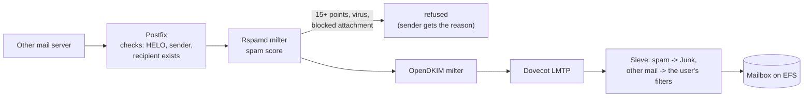

# How the Flashlight server works

This document describes how a Flashlight mail server is built and how it behaves: what the stacks create, how an
instance installs itself, where the data are, how mail flows through the server, and what protects it. It is
for administrators who want to understand the server in depth, and for developers of Flashlight. The day-to-day
tasks are in the [installation guide](INSTALL.md).

## The main idea

The data and the server are kept apart. Everything that must survive (mail, databases, certificates, keys,
passwords, the admin's settings) lives on Amazon EFS. The EC2 instance holds only the operating system and the
programs, and is disposable: any instance can be replaced at any time by a new one that installs itself from
scratch, mounts the same EFS, takes the same Elastic IP and carries on.

So there is one way the server comes into being, and it is used for everything: the first install, a Spot
interruption, a failed instance, a scheduled rebuild, a change of the instance type, an upgrade. Each of these
is "a new instance installs itself over the existing data".

## Stacks and resources

### Stage 1: `1-dns-preset.yaml`

| Resource | Purpose |
|---|---|
| Elastic IP | The server's permanent address |
| S3 config bucket | The installer files of the release; `install-logs/` (logs of failed installs, 90 days); `upload/` (the admin's folder) |
| Lambda DownloadBundles | Copies the release's installer files from the public Flashlight bucket into the config bucket. Runs on every stack create and update |
| Lambda DnsPreset | Finds the newest Flashlight image (AMI) and copies it into the account's region if needed, waiting until the copy can be used; creates the A records of `mail.` and `admin.` in the main zone and an MX record in every mail zone; sets reverse DNS of the Elastic IP to `mail.<main domain>`. On deletion, or when a domain leaves the list, it removes Flashlight's values from these records and from DKIM, SPF and DMARC, leaving other values of the same records alone |
| Log groups | The logs of the two functions |

The stage 2 stack reads stage 1's outputs (the address, the bucket, the image, the domains) through
CloudFormation exports. That's why stage 1 can't change its domain list while stage 2 uses it.

### Stage 2: `2-deployment.yaml`

| Resource | Purpose |
|---|---|
| VPC, Internet gateway, 3 public subnets, route table | The network, one subnet per Availability Zone (2 with TwoAZoneConf) |
| Instance security group | Inbound 22, 25, 80, 143, 443, 465, 587, 993 from anywhere |
| EFS file system, 3 mount targets, security group | The mail storage, reachable from the instance only (NFS) |
| IAM role and instance profile | What the instance may do in AWS (see [Security](#security)) |
| Launch template | Image, type, encrypted root disk, UserData |
| Auto Scaling group | Exactly one instance (min = max = 1) in any of the zones, Spot or On-Demand |

The Auto Scaling group uses a mixed instances policy with up to two interchangeable types (InstanceType and
InstanceType2) and, for Spot, the `price-capacity-optimized` allocation strategy. It waits up to 20 minutes for
the instance's success signal (CreationPolicy). A stack update that changes the launch template creates a new
Auto Scaling group (AutoScalingReplacingUpdate): the old instance runs until the new one has signalled success,
and if the new one fails, the update rolls back and the old one stays.

The template's Rules refuse combinations that can't work: a Spamhaus key or the antivirus without the spam
filter, the antivirus on small instance types, swap on a disk that's too small.

### Maintenance mode: `x-maintenance.yaml`

The same template as stage 2 without the launch template and the Auto Scaling group, generated from it by
`build/make-maintenance.py`. Updating stage 2 to it removes the instance and keeps everything else: the network,
EFS, the IAM role. It's used for upgrades and for changing the domain list.

## The life of an instance

### Install

1. **UserData** (in the launch template) sets up the basics: turns SELinux off, makes the AWS CLI retry
   temporary errors, updates the operating system (`dnf upgrade`), installs the AWS CLI, then downloads and runs
   `base.sh` from the config bucket. The install log goes to the root-only `/var/log/flashlight-install.log`
   (its trace contains generated passwords).
2. **`base.sh`** does the rest:
   - mounts EFS (TLS) at `/mnt/mailserver` and installs the helper scripts;
   - stops if the data on EFS belong to a newer Flashlight release;
   - associates the Elastic IP;
   - writes its own flag `flag-ec2id-<instance id>` on EFS, which makes any other running instance stop its
     services (see [Only one instance](#only-one-instance));
   - creates swap, quiets known harmless warnings, installs the packages;
   - starts MariaDB and, if the data are from an older release, upgrades them (see [UPGRADING](UPGRADING.md));
   - rebuilds every configuration file from the release, then applies the admin's own settings files;
   - on the first install only: creates the databases, the passwords, the certificates;
   - adds new domains of the stack to PostfixAdmin, creates DKIM keys and DNS records;
   - writes the list of its services for the helper scripts.
3. **`user-script.sh`**, if the admin put one into the config bucket, runs next. Its failure is reported
   (`USER` line) but doesn't fail the install.
4. **`install-finish result`** decides: on success it writes the EFS `flag` (the first install is done) and
   schedules a check for after the reboot; on failure, see below. After a good install the instance reboots, into
   the new kernel if the update brought one. A failed install doesn't reboot, so the services configured before
   the failure never start on a half-configured server.
5. **`install-finish ready`** runs once after the reboot: when all services of the list are up (it waits up to
   2 minutes), it writes `READY` to the event log and signals SUCCESS to CloudFormation.

An install takes 4 to 10 minutes, depending on the instance type and on whether the antivirus database must be
downloaded.

### When an install fails

`install-finish` keeps the install log in the config bucket (`install-logs/`), which survives even when the stack
rolls back and deletes the EFS, and writes a `FAILED` line naming the command that failed. Then:

- **during a stack create or update:** it signals FAILURE at once, so the rollback starts in a minute instead of
  after the 20-minute timeout. No retry: the person running the update takes over.
- **during a replacement by the Auto Scaling group** (Spot, price check, rebuild, health check): it tries a new
  instance after 5 minutes, up to 3 failed installs in 3 hours. After that the last instance stays up for
  diagnosis.

If the install can't even start (the AWS CLI can't be installed, or the config bucket can't be read), there is no
`install-finish` to report it: the instance turns itself off after 5 minutes, which terminates it, and the Auto
Scaling group starts a new one.

### Replacements

| Cause | What happens |
|---|---|
| Spot interruption | `spot-instance-shutdown` (the `autoshutdown` service) watches the instance metadata for the 2-minute notice. On it, `replace-instance` stops the services cleanly and asks the Auto Scaling group for a new instance |
| Weekly Spot price check | `spotprices.py`, Saturday-to-Sunday night 01:15: if this instance's pool (type and zone) averaged 7 days at a price noticeably above the cheapest allowed pool, the instance asks to be replaced; the group picks the new pool |
| Scheduled rebuild | `rebuild-check`, Sundays 03:15: once the instance is older than RebuildAfterDays, it asks to be replaced, so the server runs on current packages |
| Failed instance | The Auto Scaling group's EC2 health check replaces it |
| Stack update | A new Auto Scaling group with a new instance; the old one is removed after the new one's success |

In each case the new instance goes through the same install. Mail is down for about 4 to 6 minutes; other mail
servers retry and deliver later.

### Only one instance

Two instances must never write to the same data. The Auto Scaling group has at most one instance, but during a
stack update there are two groups for a while. The `double-inst-prot` service runs `services-shutdown`, which
watches the EFS flags: when a newer instance writes its flag, this one stops every service that writes to EFS
(MariaDB, Postfix, Dovecot, Rspamd, Valkey, cron, the timers...) and waits. Usually it's terminated soon after.
If instead the newer instance is terminated first (its install failed and the update rolled back), this one
takes over again: its flag, its services, the Elastic IP. It doesn't take over data that the newer instance has
already upgraded to a newer release.

### The event log

`/mnt/mailserver/log/instance.log` has one line per event, with the time, instance ID, type and zone:

| Event | Meaning |
|---|---|
| BOOT | A new instance starts installing |
| READY | Installed, rebooted, services up |
| FAILED | An install failed, with the reason and where the log is |
| REPLACE | The instance asks for a replacement, and why |
| SHUTDOWN, REBOOT, STOP, RESUME | The instance goes down, stops its services for another one, or takes over again |
| UPGRADE | Data upgrades between releases |
| CERT | Changes of the certificate |
| MAILBOX | Clean-up of deleted mailboxes |
| BACKUP | The daily database dump |
| ALERT | A mailbox that may be compromised |
| CHECK, ERROR | The weekly Spot price check: its decision with the prices, or why it couldn't compare |
| WARN | Something worked with a fallback (swap made smaller, the Rspamd repository unreachable...) |
| USER | The admin's user-script.sh failed |

## Data on EFS

| Path | Contents |
|---|---|
| `mail/<domain>/<address>/` | Mailboxes (Maildir), owned by the `vmail` user (5000) |
| `mail/sieve/`, `mail/shared-folders/` | Users' Sieve filters, shared folders |
| `mail/.deleted/` | Mail of deleted mailboxes, kept 30 days |
| `mysql/` | MariaDB data |
| `spool/postfix/` | The Postfix queue |
| `etc/letsencrypt/` | Certificates |
| `etc/postfix/dkim/` | DKIM keys and OpenDKIM's config |
| `etc/crontab` | The system crontab: Flashlight's block and the admin's own lines |
| `etc/<program>/` | The admin's own settings files |
| `www/admin/` | PostfixAdmin and phpMyAdmin with their configs, the admin site's password file |
| `www/webmail/` | Roundcube's logs |
| `rspamd/` | The spam filter's web interface settings, statistics, graphs, whitelist |
| `valkey/` | What the spam filter has learned |
| `clamav/` | The antivirus signatures |
| `root/` | `credentials`, `secrets` (generated passwords and keys), the fail2ban note |
| `automation/` | The cron scripts |
| `backup/` | Database dumps (28 days) and upgrade backups (90 days) |
| `log/` | `instance.log`, install logs (90 days), the cron scripts' logs |
| `versions` | The Flashlight release of the data, and what the instance runs |
| `flag`, `flag-ec2id-<id>` | The first install is done; the instance that owns the EFS now |

The file system outlives the stack (`DeletionPolicy: RetainExceptOnCreate`): deleting the stage 2 stack leaves it
in the account, to be deleted by hand. EFS is encrypted at rest, and the instance mounts it over TLS. With MailStorageLifecyclePolicy, files not read
for a while move to the Infrequent Access class.

## Configuration: ours and the admin's

Flashlight's configuration files are rewritten from the release at every install, so they always match the
installed programs and the release. They live on the instance (in `/etc`) and carry a "DON'T EDIT" header. A
handful of values in them come from the stack's parameters and from `root/secrets`.

The admin's settings live in separate files on EFS, created once with an explanation and never changed by
Flashlight. Each program reads them after ours, so they win:

| Program | The admin's file | How it is applied |
|---|---|---|
| Postfix | `etc/postfix/main.local.cf` | Each setting applied with `postconf -e` at boot; a rejected one is reported and skipped |
| Dovecot | `etc/dovecot/custom.conf` | Included at the end of `dovecot.conf` |
| Apache | `etc/httpd/custom.conf`, `custom-mail.conf`, `custom-admin.conf` | Global, inside the webmail site, inside the admin site |
| MariaDB | `etc/mariadb/custom.cnf` | Read after `flashlight.cnf` |
| Rspamd | `etc/rspamd/override.d/` | Linked as `/etc/rspamd/override.d`; a file replaces the whole section of that name |
| fail2ban | `etc/fail2ban/custom.local` | Read after `jail.local` |
| Roundcube, PostfixAdmin, phpMyAdmin | `etc/roundcube/custom.inc.php`, `etc/postfixadmin/custom.php`, `etc/phpmyadmin/custom.php` | Included at the end of our config |

The crontab is shared: Flashlight's jobs are between `# Flashlight begin` and `# Flashlight end`, rewritten at
every boot; lines outside belong to the admin.

## Services

| Service | Role | Listens on |
|---|---|---|
| Postfix | SMTP: receives and sends mail | 25 (other servers), 587 and 465 (users) |
| Dovecot | IMAP, login checks for Postfix, delivery (LMTP, a Unix socket for Postfix only), ManageSieve | 143, 993; 4190 (closed from outside) |
| OpenDKIM | Signs outgoing mail | 127.0.0.1:8891 |
| MariaDB | The PostfixAdmin, Roundcube and phpMyAdmin databases | Unix socket only |
| Apache + PHP-FPM | Webmail, the admin site | 80 (redirects), 443 |
| Rspamd | The spam filter (milter, workers, web interface) | 127.0.0.1:11332-11334 |
| Valkey | Rspamd's learned data | 127.0.0.1:6379 |
| Unbound | Rspamd's DNS resolver | 127.0.0.1:53 |
| olefy | Macros in Office documents (oletools) for Rspamd | 127.0.0.1:10050 |
| clamd, freshclam | Virus scanning, signature updates (Antivirus) | 127.0.0.1:3310 |
| fail2ban | Bans after failed logins | |
| cron, timers | Scheduled jobs, log rotation, certificate renewal | |
| double-inst-prot | Only one instance at a time | |
| autoshutdown | Spot interruption watcher (Spot) | |

Services that use EFS start only when it is mounted (`RequiresMountsFor`) and not at all if it isn't, so MariaDB
can't start on an empty local folder. A service starts after the services it uses: Postfix, Dovecot and
PHP-FPM after MariaDB, Apache after PHP-FPM, Rspamd after Valkey, Unbound and olefy, fail2ban after the services
whose logs it reads. These are ordering dependencies only: restarting MariaDB doesn't restart Postfix.

`/usr/local/etc/flashlight-services` lists the services of this instance (they depend on the stack's
parameters): `services_running` must be up after an install, `services_efs` write to EFS and are stopped
together when another instance takes over or this one is replaced.

MariaDB is the last process the kernel stops when memory runs out (`OOMScoreAdjust=-500`): without it, logins
and mail lookups fail, while Rspamd and the PHP workers come back by themselves. A swap file of half the memory
(at most 4 GB) absorbs short peaks. PHP-FPM's pool is sized by memory, about 10 processes per 2 GB.

## Mail flow

### Incoming mail (port 25)

1. **Postfix** accepts the connection. Limits per client address: 20 connections at once, 30 connections and 30
   messages a minute. It refuses invalid HELO names, unknown sender domains, recipients it doesn't host, and
   relaying for anyone not logged in. Domains, mailboxes and aliases come from the PostfixAdmin database.
2. **Rspamd** (first milter) scores the message (see [Spam filter](#spam-filter)). From 15 points, or for a virus
   or a blocked attachment, the message is refused during the SMTP session, so the sender learns about it. Over
   6 points it gets an `X-Spam: Yes` header.
3. **OpenDKIM** (second milter) only signs; with the spam filter, Rspamd has already checked SPF, DKIM, DMARC
   and ARC and written the Authentication-Results header. Without the spam filter OpenDKIM verifies too.
4. **Dovecot** delivers through LMTP. A global Sieve script (`sieve_before`) puts mail with `X-Spam: Yes` into
   Junk and stops there, so the user's own filters and vacation replies never answer spam. Other mail goes
   through the user's filters. Mailbox quotas from PostfixAdmin apply.

If a milter is down, mail still flows, unchecked or unsigned (`milter_default_action = accept`).

### Outgoing mail (ports 587 and 465)

1. The user logs in (Postfix asks Dovecot). Login is only possible on 587 (after STARTTLS) and 465, with TLS
   1.2 or newer; port 25 has no login, so passwords can't be guessed through it.
2. Postfix checks that the user sends as their own address or an alias that delivers to their mailbox
   (`reject_authenticated_sender_login_mismatch`), and allows at most 20 recipients per message.
3. Rspamd counts the user's messages: over 30 an hour or 300 a day, the message is refused for now. Messages it
   scores at 15 points or more, or with a virus or a blocked attachment, are refused. Outgoing mail never gets a
   spam header.
4. OpenDKIM signs it with the domain's key. Postfix delivers it, with TLS when the receiving server offers it.

Webmail sends the same way, logging in to Postfix on the server itself. Mail generated on the server (cron,
PostfixAdmin, the alerts) is only signed. Undeliverable mail is retried for a day, then bounced.

## Spam filter

With Antispam (the default), the spam filter is Rspamd 4.3 with its own helpers:

- **Rspamd** comes from its official repository, pinned to version 4.3 (its bug-fix releases come by themselves; a newer version comes with a Flashlight release, after testing) and checked with the signing key that
  comes with the release. If the repository is unreachable, the copy of the package in the release is installed
  after a signature check (`WARN` line).
- **Valkey** (a Redis fork) keeps the Bayes statistics, fuzzy hashes and rate limit counters, on EFS, written
  at most 5 minutes after a change. Memory is capped at 256 MB; the data expire by themselves.
- **Unbound** is Rspamd's own DNS resolver: blocklists refuse queries that come through big shared resolvers,
  AWS's included.

### What it checks

Rspamd's standard modules: SPF, DKIM, DMARC and ARC, blocklists of sending addresses and of links in the
message, the Bayes filter, fuzzy hashes, the message's structure and headers, phishing, MIME types of
attachments. Added by Flashlight:

| Check | Setting | Effect |
|---|---|---|
| Spamhaus via DQS | SpamhausDQSKey | Spamhaus's address, domain and hash lists, queried with the key (Spamhaus refuses AWS without one) |
| Risky attachments | AttachmentPolicy = Gmail or Strict | `BLOCKED_ATTACHMENT` finds file types from the release's lists (`attachments-gmail.map`, `attachments-strict.map`), also inside archives; the message is refused with an explanation for the sender. Encrypted archives and archives inside archives go at least to Junk |
| Macros in Office documents | always (if oletools installed) | olefy passes Office files to oletools; a macro that runs by itself and does suspicious things adds 7 points (Junk). If pip can't install oletools, the server works without the check (`WARN` line) |
| Viruses | Antivirus | ClamAV scans every part of the message; a virus is refused. The signature database is on EFS, so a new instance only updates it |
| Partner whitelist | `rspamd/whitelist-domains.map` | −6 points for a listed domain whose SPF or DKIM passes |

Thresholds: 6 points add the spam header (Junk), 15 refuse the message. No greylisting: it delays legitimate
mail.

### Learning

Rspamd's Bayes filter learns by itself from mail that scores very high or very low, and from the users:
Dovecot's imapsieve runs a script when a message is moved into Junk (learn as spam) or out of Junk to any folder
but Trash (learn as not spam), and passes the message to Rspamd. This works from any mail program. Roundcube
adds Spam and Not spam buttons (the `markasjunk` plugin), which move the message the same way.

### Web interface

`https://admin.<main domain>/rspamd/`, behind the admin site's password and Rspamd's own password (in
`/root/credentials`). It shows the history of checked messages with the checks that fired, statistics and graphs,
and edits the whitelist. Apache drops the browser's own `X-Forwarded-For` header and passes the real address,
so Rspamd always asks for its password; only requests from the server itself (the learning) don't need it.
Settings changed in the web interface, statistics and graphs are on EFS.

### Outgoing mail and compromised mailboxes

A stolen password is the most common way a small mail server ends up on blocklists. Besides the limits above,
`outbound-alert` runs every 10 minutes: it reads Rspamd's log for refused messages of logged-in users (over the
limits, or as spam, a virus or a blocked attachment) and e-mails the admin about each such user at most every 6
hours, with an `ALERT` line in the event log. The limits can be changed by the admin
([how](INSTALL.md#limits-on-outgoing-mail)).

## DNS and certificates

| Record | Created by | When |
|---|---|---|
| A of `mail.` and `admin.` | Stage 1 Lambda | Stack create and update |
| MX of every domain (`10 mail.<main domain>`) | Stage 1 Lambda | Stack create and update |
| Reverse DNS of the Elastic IP | Stage 1 Lambda | Stack create and update |
| SPF (`v=spf1 ip4:<EIP> -all`) | `dnsupd.py` on the server | Every install, unless the record already allows the address |
| DKIM (`<selector>._domainkey`, RSA) | `dnsupd.py` on the server | Every install |
| DMARC (`p=reject`) | `dnsupd.py` on the server | Only when the domain has no DMARC record |

`dnsupd.py` keeps other TXT values of the domain (site verifications, for example). It also keeps the admin's
own records: an SPF record that already allows the server's address (with an `include:` of another mail service,
say) and any existing DMARC record. A domain removed from the stack loses its DKIM key and Flashlight's records.

The certificate (Let's Encrypt, RSA) covers `mail.<main domain>` and `admin.<main domain>`; it is used by
Postfix, Dovecot and Apache. Certbot validates through DNS (`_acme-challenge` TXT records in Route 53), so no
port has to be open for it. It renews twice a day if due (`certbot-renew.timer`) and reloads the services only
when a new certificate was issued. With CertificateMode `staging` the certificate comes from the Let's Encrypt
test CA; switching to `production` with a stack update replaces it on the next install.

## Scheduled jobs

| When | Job |
|---|---|
| Every 10 minutes | `mailbox-cleanup`: mail of mailboxes deleted in PostfixAdmin moves to `mail/.deleted/` (30 days), their Roundcube data are deleted |
| Every 10 minutes | `outbound-alert` (spam filter) |
| Daily 22:55 | `db-backup`: dumps of all databases to `backup/`, 28 days |
| Saturday-to-Sunday 01:15 | `spotprices.py` (Spot) |
| Sundays 03:15 | `rebuild-check` (RebuildAfterDays > 0) |
| Twice a day | Certificate renewal |
| Daily | Log rotation: the logs on EFS are rotated weekly and kept 13 weeks |

Times are in the server's time zone (TimeZone).

## Security

- **Instance metadata for root only.** The metadata service (169.254.169.254) hands the instance role's AWS
  credentials to any local process. A firewall rule (nftables, `flashlight_imds`) lets only root reach it, so
  a broken-into web application, which runs as `apache`, doesn't get the server's rights in AWS. All of
  Flashlight's AWS calls run as root; a non-root program of your own that needs AWS access is refused there.
- **Network.** Only the mail, web and SSH ports are open. EFS accepts connections from the instance's security
  group only. IPv6 is off.
- **Encryption.** EFS is encrypted at rest and in transit (TLS mount). The instance's root disk is encrypted with
  the AWS-managed key, so swap is too. Users connect with TLS 1.2 or newer; port 25 offers TLS to other servers.
- **The instance's rights in AWS** (IAM role): associate the Elastic IP; change TXT records only, in the stack's
  zones only; replace only its own stack's instances; signal its own stack; read the config bucket, write
  `install-logs/`, and full access to `upload/`. It can't change the installer files, so a compromised server
  can't plant a modified installer for the next instances.
- **Passwords.** Generated on the first install, kept in `root/secrets` and `root/credentials` (root only). The
  admin tools are behind the admin site's password (basic auth over HTTPS) and their own logins.
- **fail2ban** bans addresses after repeated failed logins to SSH, mail and webmail (nftables).
- **The server's reputation.** No open relay; users send only as their own addresses, with limits; the admin is
  warned about compromised mailboxes; DMARC `p=reject` stops others from forging your domains.

## Logs

| Log | Contents |
|---|---|
| `/mnt/mailserver/log/instance.log` | The server's events (see [The event log](#the-event-log)) |
| `/mnt/mailserver/log/install/` | Install logs of all instances, 90 days |
| `/mnt/mailserver/log/` | The logs of the cron scripts |
| `/var/log/maillog` | Postfix and Dovecot |
| `/var/log/rspamd/rspamd.log` | Rspamd, one line per checked message |
| `/var/log/httpd/` | Apache |
| `/mnt/mailserver/www/webmail/logs/` | Roundcube |
| `journalctl` | All services |

Logs on the instance's own disk are lost when the instance is replaced; the ones on EFS stay.

## Backups

- **Databases:** dumped every night to `backup/` on EFS, kept 28 days. They are consistent snapshots taken without
  locking, so mail keeps flowing.
- **Everything:** with MailStorageBackupPolicy, AWS Backup backs up the whole EFS every day.
- **Upgrades:** before a data upgrade, the new instance backs up the databases and the `etc`, `www`, `root` and
  `automation` folders, and restores them if the upgrade fails ([UPGRADING](UPGRADING.md)).

## Releases and upgrades

A release is the three templates plus the installer files in the public bucket under its version
(`mail-server-bundles/v1.0/`). Stage 1 copies them into the config bucket, and every instance installs from
there. Data changes between releases are migrations, run in order by the new instance. How to upgrade:
[UPGRADING](UPGRADING.md). How a release is made: [RELEASING](RELEASING.md).

## Software

| Component | Version | Source |
|---|---|---|
| AlmaLinux | 10 | Flashlight's image, updated at every install |
| Postfix | 3.8 | AlmaLinux |
| Dovecot (with Pigeonhole) | 2.3 | AlmaLinux |
| OpenDKIM | 2.11 | EPEL |
| MariaDB | 10.11 | AlmaLinux |
| Apache, PHP-FPM | | AlmaLinux |
| Roundcube | 1.7 | The release (pinned) |
| PostfixAdmin | 4.0 | The release (pinned) |
| phpMyAdmin | 5.2 | The release (pinned) |
| Certbot with the Route 53 plugin | | EPEL |
| Rspamd | 4.3 | Rspamd's repository, or the release's copy |
| Valkey, Unbound | | AlmaLinux |
| oletools (olefy) | 0.60.2 | PyPI with pinned hashes; olefy.py in the release |
| ClamAV | 1.4 | EPEL |
| fail2ban | | EPEL |
